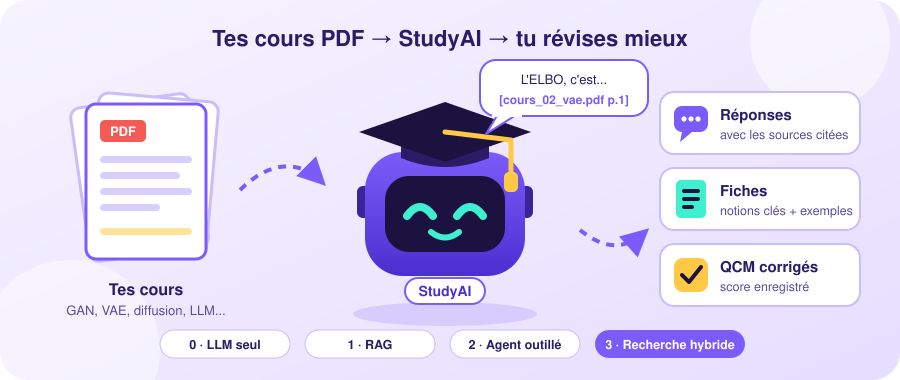
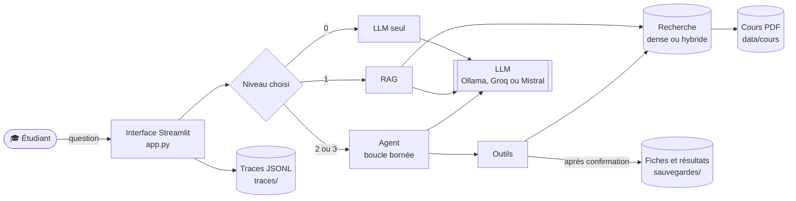
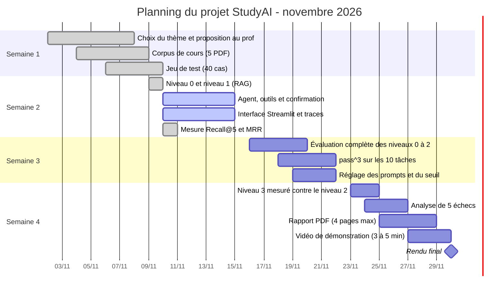

<p align="center">
  
</p>

<h1 align="center">StudyAI</h1>

<p align="center">
  <b>📚 Tu as tes cours en PDF et un partiel qui approche ? StudyAI les lit avec toi et t'aide à réviser.</b>
</p>

<p align="center">
  
  
  
  
  
</p>

---

## 📌 Sommaire

1. [Le contexte](#-le-contexte)
2. [À quoi sert StudyAI ?](#-à-quoi-sert-studyai-)
3. [Les 4 niveaux](#-les-4-niveaux)
4. [Comment ça marche ?](#%EF%B8%8F-comment-ça-marche-)
5. [Installation](#-installation-pas-à-pas)
6. [Mode d'emploi](#-mode-demploi)
7. [Évaluation](#-évaluation)
8. [Structure du dépôt](#%EF%B8%8F-structure-du-dépôt)
9. [Planning (Gantt)](#-planning-gantt)
10. [L'équipe](#-léquipe)
11. [Limites](#%EF%B8%8F-limites-connues)

---

## 🎯 Le contexte

StudyAI est notre projet pour la **mineure IA générative** (ECE Paris, ING5, 2026), encadrée par **Dr. Issam Falih**.
Nous avons choisi le **parcours Texte** : *« un assistant qui lit, agit et se mesure »*.

**Le problème de départ :** quand on révise avec un chatbot classique, il répond avec ce qu'il a appris sur Internet, pas avec **notre** cours. Il peut se tromper, inventer une définition (on appelle ça une *hallucination*) et il ne dit jamais d'où vient sa réponse.

**Notre idée :** un assistant qui s'appuie **uniquement sur les supports de cours** de l'étudiant, qui **cite la page** d'où vient chaque information et qui **dit franchement quand la réponse n'est pas dans le cours**. En plus de répondre, il peut **agir** : rédiger et enregistrer une fiche, construire un QCM et noter le score obtenu.

Le sujet impose de construire le système **en 4 niveaux** et de **mesurer** ce que chaque niveau apporte (et ce qu'il coûte) avec le même protocole de test.

---

## 💡 À quoi sert StudyAI ?

<p align="center">
  
</p>

| Je veux... | StudyAI... |
|---|---|
| ❓ **comprendre une notion** | cherche dans mes PDF et répond en citant la source, par exemple `[cours_03_gan.pdf p.1]` |
| 🗂️ **une fiche de révision** | rédige une fiche (notions clés, définitions, exemple) et l'enregistre **après ma confirmation** |
| ✅ **m'entraîner** | génère un QCM à 4 choix à partir du cours, le corrige et explique chaque réponse |
| 📈 **suivre mes progrès** | enregistre mes scores et affiche ma moyenne |
| 📄 **ajouter mes cours** | importe de nouveaux PDF directement depuis l'interface |

Le corpus fourni dans `data/cours/` contient **5 cours que nous avons rédigés nous-mêmes** (réseaux de neurones, VAE, GAN, diffusion, LLM/RAG/agents). Il n'y a donc aucune donnée personnelle et aucun document protégé.

---

## 🪜 Les 4 niveaux

Chaque niveau reste disponible dans l'interface **et** dans le script d'évaluation, pour pouvoir les comparer.

| Niveau | Ce qu'il fait | Ce qu'il apporte | Sa limite |
|:---:|---|---|---|
| **0 · LLM seul** | un prompt soigné, sans documents ni outils | la référence à battre | ne connaît pas le cours, réponses invérifiables |
| **1 · RAG** | découpe les PDF, cherche les 5 passages les plus proches (embeddings), répond **en citant ses sources** et **s'abstient** si rien n'est trouvé | réponses fidèles au cours | ne peut rien faire (pas de fiche, pas de score) |
| **2 · Agent outillé** | boucle *raisonner → appeler un outil → observer* écrite **à la main**, 5 outils, **confirmation avant toute écriture** | traite des tâches en plusieurs étapes | consomme plus de tokens |
| **3 · Extension** | même agent, mais avec une **recherche hybride** (embeddings + BM25 fusionnés avec RRF) | retrouve mieux les mots précis (ELBO, DDIM, FID...) | un peu plus de calcul |

**Les outils de l'agent** (décrits par un schéma JSON dans `studyai/outils.py`) :

| Outil | Effet | Règles vérifiées par le code |
|---|---|---|
| `rechercher_cours` | 📖 lecture | ne renvoie que les passages au-dessus du seuil de similarité |
| `construire_qcm` | 📖 lecture | 1 à 10 questions, exactement 4 choix, indice de bonne réponse entre 0 et 3 |
| `lister_sauvegardes` | 📖 lecture | — |
| `enregistrer_fiche` | ✍️ **écriture → confirmation** | titre non vide, 50 caractères minimum, au moins **une source qui existe** dans les cours |
| `enregistrer_resultat` | ✍️ **écriture → confirmation** | `total ≥ 1` et `0 ≤ score ≤ total` (un « 12 sur 10 » est refusé) |

La boucle de l'agent est **bornée** : 6 appels au LLM maximum et un budget de tokens. Les erreurs des outils sont **renvoyées au modèle** au lieu de faire planter le programme.

---

## ⚙️ Comment ça marche ?



1. **Lecture des cours** (`documents.py`) : chaque PDF est lu page par page puis découpé en morceaux de **80 mots** qui se chevauchent de 20 mots. Pourquoi 80 ? Le modèle d'embeddings lit au maximum 128 tokens, et 80 mots en français font environ 110 tokens. Avec des morceaux plus longs, la fin du texte serait coupée.
2. **Embeddings** (`recherche.py`) : on utilise `paraphrase-multilingual-MiniLM-L12-v2`. C'est un petit modèle **multilingue** (nos cours sont en français) qui tourne **sur CPU**, sans GPU. Les vecteurs sont mis en cache dans `data/index/`.
3. **Recherche** : similarité cosinus (niveaux 1-2), ou fusion **RRF** de la recherche dense et de **BM25 écrit à la main** (niveau 3).
4. **Génération** : n'importe quel LLM compatible avec l'API OpenAI. Le client est une simple requête HTTP (`llm.py`), sans framework.
5. **Traces** : chaque exécution est enregistrée en JSONL avec les étapes, les outils, les arguments, les tokens et la durée.

> Le sujet demande qu'au moins un composant soit écrit sans framework. Chez nous, ce sont **la boucle de l'agent, la validation des actions, BM25 et l'évaluation**.

---

## 🚀 Installation (pas à pas)

**Prérequis :** Python 3.10 ou plus. Pas besoin de GPU.

```bash
# 1. Récupérer le projet
git clone https://github.com/Ismail-cherchar/StudyAI.git
cd StudyAI

# 2. Créer un environnement virtuel
python -m venv .venv
# Windows :
.venv\Scripts\activate
# macOS / Linux :
source .venv/bin/activate

# 3. Installer les dépendances
pip install -r requirements.txt

# 4. Configurer le LLM
cp .env.example .env        # sous Windows : copy .env.example .env
```

**Choisir un LLM** (dans le fichier `.env`) :

- **Option conseillée, modèle ouvert en local :** installer [Ollama](https://ollama.com), puis lancer `ollama pull qwen2.5:7b`. Le `.env` par défaut fonctionne directement.
- **Option rapide sur un PC sans GPU :** créer une clé gratuite sur Groq, puis décommenter les 3 lignes « Option 2 » du `.env`.

> 🔒 Le fichier `.env` contient ta clé d'API. Il est dans le `.gitignore` et ne doit **jamais** être publié sur GitHub.

Au premier lancement, le modèle d'embeddings (~470 Mo) se télécharge automatiquement.

---

## 🧭 Mode d'emploi

### Lancer l'application

```bash
streamlit run app.py
```

La page s'ouvre dans le navigateur (http://localhost:8501).

### Ce que tu vois

- **Barre latérale** : le menu (Chat, QCM, Mes fiches), le **choix du niveau** (0 à 3), l'import de PDF et le **coût de la dernière réponse** (tokens et latence).
- **💬 Chat** : tu poses ta question. Sous chaque réponse, tu trouves les **sources** et la **trace** de l'exécution.
- **📝 QCM** : tu choisis un sujet et un nombre de questions, tu réponds, tu cliques sur *Corriger*, puis tu enregistres ton score si tu veux.
- **📚 Mes fiches et résultats** : tes fiches enregistrées et l'historique de tes scores.

### Exemples de demandes

| Demande | Niveau conseillé | Ce qui se passe |
|---|:---:|---|
| « Que signifie ELBO ? » | 1 | réponse tirée du cours de VAE, avec la page citée |
| « Comment fonctionne un LSTM ? » | 1 | **abstention** : ce n'est pas dans les cours, donc StudyAI ne l'invente pas |
| « Fais une fiche sur les GAN et enregistre-la » | 2 ou 3 | l'agent cherche dans le cours, rédige la fiche, puis **demande ta confirmation** avant d'enregistrer |
| « J'ai eu 4 sur 5 au QCM sur les GAN, enregistre mon résultat » | 2 ou 3 | proposition d'enregistrement → bouton ✅ Confirmer / ❌ Refuser |
| « Enregistre mon score » | 2 ou 3 | demande trop vague : l'agent **pose une question** au lieu d'agir |
| « Donne-moi la recette des crêpes » | tous | refus poli, car hors sujet |

### Où sont rangées les données ?

| Dossier / fichier | Contenu |
|---|---|
| `data/cours/` | les cours PDF (ajoute les tiens ici ou via l'interface) |
| `sauvegardes/fiches.json` | les fiches enregistrées |
| `sauvegardes/resultats.json` | les scores de QCM |
| `traces/traces.jsonl` | une ligne par exécution, pour l'analyse d'erreurs |

---

## 📏 Évaluation

### Le jeu de test : `data/tests.jsonl` (40 cas)

| Type de cas | Nombre | Ce que l'on vérifie |
|---|:---:|---|
| Réponse dans les cours | 20 | mots-clés attendus présents + source citée et réellement lue ; passage pertinent annoté pour Recall@5 / MRR |
| Réponse absente des cours | 5 | l'assistant s'abstient |
| Tâches en plusieurs étapes | 10 | **état final vérifié par du code** (fiche ou score enregistré, QCM construit, rien d'enregistré si 12/10) |
| Demandes ambiguës ou hors sujet | 5 | question de précision ou refus, et rien d'enregistré |

### Les métriques

- **Recherche** : Recall@5 et MRR
- **Réponse** : exactitude (règles par mots-clés) et fidélité aux sources
- **Agent** : succès des tâches et **pass^3** (les 3 essais doivent réussir)
- **Coût** : tokens et latence par requête

### Lancer l'évaluation

```bash
python eval.py                  # les 4 niveaux et le tableau complet
python eval.py --recherche      # seulement Recall@5 et MRR (pas besoin du LLM)
python eval.py --niveaux 1 3    # seulement certains niveaux
python eval.py --limite 2       # test rapide : 2 cas par type
pytest                          # tests unitaires (sans LLM)
```

Les résultats sont écrits dans `resultats/` : `tableau.md`, `recherche.md` et `niveau_X.jsonl` pour les réponses brutes. Les traces de l'évaluation sont dans `traces/`.

### Premiers résultats : la recherche seule (10/11/2026)

Sur les 20 questions présentes dans les cours, avec `python eval.py --recherche` :

| Moteur | Recall@5 | MRR |
|---|:---:|:---:|
| BM25 seul | 100 % | 0.84 |
| Dense (niveaux 1 et 2) | 95 % | 0.65 |
| **Hybride (niveau 3)** | **100 %** | **0.80** |

👉 La recherche hybride retrouve le bon passage plus souvent **et plus haut** dans la liste que la recherche dense seule. C'est ce qui justifie notre extension. Il faudra encore vérifier que ce gain se retrouve dans l'exactitude des réponses avec l'évaluation complète.

### Tableau complet des niveaux

*À remplir avec `python eval.py` une fois le LLM configuré (semaine 3).*

| Niveau | Recall@5 | Exactitude | Abstention | Succès tâches | pass^3 | Tokens / requête | Latence |
|---|:---:|:---:|:---:|:---:|:---:|:---:|:---:|
| 0 · LLM seul | — | … | … | — | — | … | … |
| 1 · RAG | 95 % | … | … | — | — | … | … |
| 2 · Agent | 95 % | … | … | … | … | … | … |
| 3 · Hybride | 100 % | … | … | … | … | … | … |

---

## 🗂️ Structure du dépôt

```text
StudyAI/
├── app.py                  # interface Streamlit
├── eval.py                 # évaluation des 4 niveaux (python eval.py)
├── studyai/
│   ├── config.py           # réglages (lus dans le .env)
│   ├── llm.py              # client LLM (simple requête HTTP)
│   ├── documents.py        # lecture des PDF + découpage
│   ├── recherche.py        # recherche dense, BM25, hybride (RRF)
│   ├── niveaux.py          # niveau 0 (LLM seul) et niveau 1 (RAG)
│   ├── outils.py           # les 5 outils de l'agent + règles métier
│   ├── agent.py            # boucle de l'agent (niveaux 2 et 3)
│   ├── traces.py           # traces JSONL
│   └── assistant.py        # assemble le tout
├── data/
│   ├── cours/              # les 5 cours PDF du corpus
│   └── tests.jsonl         # les 40 cas de test
├── tests/                  # tests unitaires (pytest)
├── resultats/              # résultats de l'évaluation
├── assets/                 # logo et illustration
├── requirements.txt
└── .env.example            # modèle de configuration (sans clé)
```

---

## 📅 Planning (Gantt)



### Où on en est

- [x] Thème validé et proposition envoyée
- [x] Corpus de 5 cours et jeu de 40 cas de test
- [x] Niveaux 0 à 3 codés, avec la boucle d'agent faite à la main
- [x] Interface Streamlit (chat, QCM, fiches, coûts, traces)
- [x] Recall@5 et MRR mesurés
- [ ] Évaluation complète avec le LLM (`python eval.py`)
- [ ] Analyse de 5 échecs
- [ ] Rapport PDF et vidéo de démonstration

---

## 👥 L'équipe

<table>
  <tr>
    <td align="center" width="220">
      <b>Adam Bouchiba</b><br>
      ING5 · ECE Paris
    </td>
    <td align="center" width="220">
      <b>Ismail Cherchar</b><br>
      ING5 · ECE Paris<br>
      <a href="https://github.com/Ismail-cherchar">@Ismail-cherchar</a>
    </td>
  </tr>
</table>

**Encadrant :** Dr. Issam Falih, Mineure IA générative 2026

---

## ⚠️ Limites connues

- **Petit corpus** : 5 cours seulement. Avec si peu de documents, trouver le bon PDF est facile, c'est pourquoi on mesure Recall@5 au niveau du **passage** annoté.
- **Le seuil d'abstention ne suffit pas toujours.** Une question hors du cours mais proche du sujet (par exemple « Qui a inventé l'algorithme de Dijkstra ? ») obtient une similarité de 0,53, plus haute que certaines vraies questions (0,40). Dans ce cas, c'est au LLM de s'abstenir, et il faut le vérifier dans l'évaluation.
- **Exactitude jugée par mots-clés** : c'est simple et reproductible, mais une bonne réponse formulée autrement peut être comptée fausse.
- **LLM local sur CPU** : un modèle 7B via Ollama est lent sans GPU, et l'agent appelle le LLM plusieurs fois par demande.

---

<p align="center">
  <sub>Projet pédagogique · Mineure IA générative · ECE Paris · 2026</sub>
</p>
